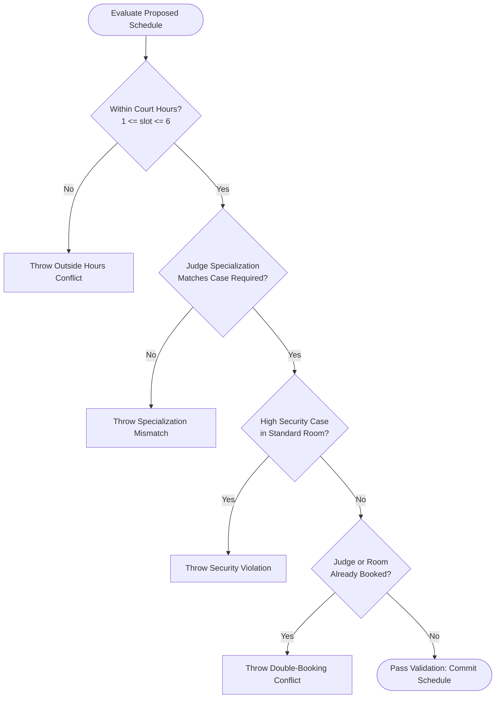

# ⚖️ Member Walkthrough: Yash (Resource Modeling, Exceptions & Business Rules)

**Project:** JuriBox — Court Case Scheduling & Trial Simulation Engine  
**Author / Team Member:** Yash  
**Course:** Object-Oriented Programming with Java (3rd Semester)  
**Timeline:** 13 November 2026 – 16 November 2026  
**Files Owned & Developed:**
1. `src/juribox/exception/CourtSchedulingException.java`
2. `src/juribox/model/Judge.java`
3. `src/juribox/model/Courtroom.java`
4. `src/juribox/model/Schedule.java`
5. `src/juribox/service/ConflictChecker.java`

---

## 📌 Executive Summary of Yash's Role

In the JuriBox architecture, **Yash is the Guardian of System Integrity and Physical Resources**.

While **Kabir** models the lawsuits (`Case`), **Tanish** writes the greedy solver (`Scheduler`), and **Lakshit** handles threads and database persistence, **Yash bridges the gap between legal policy, human jurists, and physical courthouse infrastructure**.

Yash's module answers three fundamental questions:
1. *Who can hear the case?* (Judicial Specialization & Working Hours in `Judge.java`)
2. *Where can the case physically take place safely?* (Physical Security & Facility Capacity in `Courtroom.java`)
3. *Is this hearing legally and logistically valid?* (Defense against double-booking, mismatch, and time overrun in `ConflictChecker.java` and `CourtSchedulingException.java`)

---

## 📚 Core Java OOP & Syllabus Concepts Demonstrated by Yash

| Java & OOP Concept | Where Yash Used It | Why It Was Used |
| :--- | :--- | :--- |
| **Custom Checked Exception Hierarchy** | `CourtSchedulingException.java` | Extends `java.lang.Exception` to force caller code to handle court scheduling failures defensively. |
| **Static Nested Classes** | `DuplicateEntityException`, `EntityNotFoundException`, `SchedulingConflictException` | Clean encapsulation of domain-specific exception types grouped under one parent namespace. |
| **Data Encapsulation & Validation** | `Judge.java`, `Courtroom.java`, `Schedule.java` | Defensive checking in constructors: non-null IDs, whitespace trimming, uppercase normalization, and positive integers. |
| **Collections Framework (`Map` & `Set`)** | `Judge.java`, `Courtroom.java` | `Map<String, Set<Integer>>` where `Set<Integer>` is instantiated as a `TreeSet` to maintain slot numbers in ascending, sorted order. |
| **Defensive Immutability** | `Collections.unmodifiableList(...)` | Exposes read-only views of assigned schedules so external classes cannot manipulate a judge's or courtroom's schedule directly. |
| **Domain Composition & Association** | `Schedule.java` | Acts as an association entity holding foreign keys (`caseId`, `judgeId`, `courtroomId`) plus temporal dimensions (`date`, `startSlot`, `durationSlots`). |
| **Interval Overlap Arithmetic** | `Schedule.java`, `ConflictChecker.java` | De Morgan's Law for interval non-overlap: `!(endSlot < other.start || other.end < start)`. |
| **Defensive Constraint Verification** | `ConflictChecker.java` | 4-level gatekeeper checking Court Hours, Specialization, Security, and Double-booking. |

---

# 📂 Detailed File-by-File Breakdown

---

## 1. `CourtSchedulingException.java`
**Location:** `src/juribox/exception/CourtSchedulingException.java`  
**Purpose:** Custom Checked Exception Hierarchy for Court Operations.

### Why Checked Exceptions (`extends Exception`)?
In Java, exceptions that extend `RuntimeException` are unchecked (the compiler does not force callers to handle them). However, court scheduling failures (like double-booking or lack of security clearance) are **anticipated real-world operational conflicts**. By extending `Exception`, Yash forces the service layer (`CourtManager`, `Scheduler`, `Main`) to use `try-catch` blocks or declare `throws`, ensuring no conflict fails silently.

### Architecture of the Class:
```java
public class CourtSchedulingException extends Exception {
    private static final long serialVersionUID = 1L;

    public CourtSchedulingException(String message) {
        super(message);
    }

    public CourtSchedulingException(String message, Throwable cause) {
        super(message, cause);
    }

    // Static nested subclasses representing distinct failure modes:
    public static class DuplicateEntityException extends CourtSchedulingException { ... }
    public static class EntityNotFoundException extends CourtSchedulingException { ... }
    public static class SchedulingConflictException extends CourtSchedulingException { ... }
}
```

### Key Highlights:
1. **`serialVersionUID = 1L`:** Ensures serializable compatibility across JVM versions.
2. **`DuplicateEntityException`:** Thrown if someone tries to add a Judge with ID `"J01"` or Courtroom `"CR01"` twice.
3. **`EntityNotFoundException`:** Thrown when querying a non-existent case, judge, or courtroom.
4. **`SchedulingConflictException`:** Thrown by `ConflictChecker.validateAssignment()` whenever a booking rule is broken (e.g., room already booked, judge not specialized).

---

## 2. `Judge.java`
**Location:** `src/juribox/model/Judge.java`  
**Purpose:** Models a constitutional jurist, their domain expertise, and calendar availability.

### Fields Encapsulated:
* `private String judgeId`: Unique alphanumeric identifier (e.g., `"J01"`).
* `private String name`: Formal name (e.g., `"Hon. Justice Vance"`).
* `private CaseType specialization`: Judicial domain qualification (`CIVIL`, `CRIMINAL`, or `PROPERTY`).
* `private Map<String, Set<Integer>> availableSlots`: Stores which hourly slots on each date the judge is on duty.
* `private Map<String, Set<Integer>> bookedSlots`: Stores slots already committed to active trials.
* `private List<String> assignedScheduleIds`: History of schedule references assigned to this judge.

### Core Methods & Implementation Details:

#### 1. Constructor Defensive Validation:
```java
if (judgeId == null || judgeId.trim().isEmpty()) {
    throw new IllegalArgumentException("Judge ID cannot be null or empty.");
}
this.judgeId = judgeId.trim().toUpperCase();
this.specialization = Objects.requireNonNull(specialization, "Specialization cannot be null.");
```
* Guards against dirty data right at creation time.
* Normalizes ID to uppercase for consistency across database and memory searches.

#### 2. Slot Management with `TreeSet`:
```java
public void setAvailability(String date, Set<Integer> slots) {
    availableSlots.put(date, new TreeSet<>(slots));
    bookedSlots.putIfAbsent(date, new TreeSet<>());
}
```
* **Why `TreeSet`?** A `TreeSet` guarantees that slot numbers `[1, 2, 3, 4, 5, 6]` are stored in strictly sorted order and lookups take $O(\log n)$ time with zero duplicate slots.

#### 3. Range Availability Checking (`isAvailable`):
```java
public boolean isAvailable(String date, int startSlot, int duration) {
    Set<Integer> workingSlots = availableSlots.get(date);
    if (workingSlots == null) return false;
    Set<Integer> booked = bookedSlots.getOrDefault(date, Collections.emptySet());

    for (int s = startSlot; s < startSlot + duration; s++) {
        if (!workingSlots.contains(s) || booked.contains(s)) {
            return false;
        }
    }
    return true;
}
```
* Iterates from `startSlot` to `startSlot + duration - 1`.
* Checks **both**:
  1. Is the judge working during this slot? (`workingSlots.contains(s)`)
  2. Is the judge free / not already booked? (`!booked.contains(s)`)

#### 4. Booking and Releasing Slots:
* `bookSlots(...)`: Marks slots as occupied and records the `scheduleId`.
* `releaseSlots(...)`: Used during **rescheduling** or **case adjournments** to free up the judge's calendar.

---

## 3. `Courtroom.java`
**Location:** `src/juribox/model/Courtroom.java`  
**Purpose:** Models physical courtroom infrastructure, availability, and security classification.

### Why is this class critical in Court Scheduling?
In civil and criminal litigation, physical space is not uniform. Standard rooms are fine for contract disputes, but high-risk criminal defendants require reinforced high-security facilities (ballistic partitions, prisoner dock cages, extra armed security escort passages).

### Fields Encapsulated:
* `private String courtroomId`: Room code (e.g., `"CR01"`, `"CR02"`).
* `private String roomName`: Descriptive name (e.g., `"Courtroom 2 (High Security)"`).
* `private boolean highSecurity`: Boolean flag indicating security clearance.
* `private Map<String, Set<Integer>> availableSlots`: Operational dates and slots.
* `private Map<String, Set<Integer>> bookedSlots`: Occupied slots.
* `private List<String> assignedScheduleIds`: Assigned trial schedules.

### Structural Symmetry with `Judge`:
Notice how `Courtroom` and `Judge` share identical slot tracking methods (`setDefaultAvailability`, `isAvailable`, `bookSlots`, `releaseSlots`). This intentional architectural symmetry allows the scheduling algorithm to evaluate judges and courtrooms using parallel logic.

---

## 4. `Schedule.java`
**Location:** `src/juribox/model/Schedule.java`  
**Purpose:** The immutable Association Tuple linking Litigants, Judge, Room, and Time.

### Relational Concept:
In database terminology, `Schedule` is an **Association Entity** resolving a Many-to-Many relationship between `Case`, `Judge`, and `Courtroom` over a specific timeframe:

$$\text{Schedule} = \langle \text{ScheduleID}, \text{CaseID}, \text{JudgeID}, \text{CourtroomID}, \text{Date}, \text{StartSlot}, \text{Duration} \rangle$$

### Key Mathematical & Geometric Methods:

#### 1. Calculating the End Slot:
```java
public int getEndSlot() {
    return startSlot + durationSlots - 1;
}
```
* *Example:* If a trial starts at Slot 1 and lasts 2 slots, its end slot is $1 + 2 - 1 = \text{Slot } 2$.

#### 2. The Overlap Theorem (`overlapsWith`):
```java
public boolean overlapsWith(Schedule other) {
    if (!this.date.equalsIgnoreCase(other.date)) {
        return false;
    }
    return !(this.getEndSlot() < other.getStartSlot() || other.getEndSlot() < this.getStartSlot());
}
```
* **Theory:** Two time intervals $[A_{\text{start}}, A_{\text{end}}]$ and $[B_{\text{start}}, B_{\text{end}}]$ do **NOT** overlap if:
  $$A_{\text{end}} < B_{\text{start}} \quad \text{OR} \quad B_{\text{end}} < A_{\text{start}}$$
* Therefore, by De Morgan's Law, they **DO overlap** if the negation is true:
  $$\neg(A_{\text{end}} < B_{\text{start}} \lor B_{\text{end}} < A_{\text{start}})$$

#### 3. Human-Readable Representation:
```java
public String getSlotRangeDescription() {
    if (durationSlots == 1) {
        return "Slot " + startSlot;
    } else {
        return String.format("Slot %d-%d (%d slots)", startSlot, getEndSlot(), durationSlots);
    }
}
```
* Formats `"Slot 1"` or `"Slot 1-2 (2 slots)"` for clean court causelist exports.

---

## 5. `ConflictChecker.java`
**Location:** `src/juribox/service/ConflictChecker.java`  
**Purpose:** The Multi-Constraint Judicial Validation & Rules Engine.

Yash engineered two primary entry points in `ConflictChecker`:
1. **`validateAssignment(...)` (Pre-Booking Gatekeeper):** Runs before creating a schedule. Throws a checked `SchedulingConflictException` if any rule is broken.
2. **`checkAllConflicts(...)` (Post-Audit Scanner):** Scans the entire active court calendar and returns a `List<String>` of all detected violations for analytics.

---

### 🛡️ The 4 Universal Judicial Constraints Checked by Yash:



#### Rule 1: Operating Hours Constraint
```java
int endSlot = startSlot + duration - 1;
if (startSlot < 1 || endSlot > maxDailySlots) {
    throw new SchedulingConflictException(String.format(
        "Requested slot range (%d - %d) is outside court hours (1 to %d).", 
        startSlot, endSlot, maxDailySlots));
}
```
* Prevents court sittings beyond official operating hours (Slots 1 to 6).

#### Rule 2: Specialization Constraint
```java
if (judge.getSpecialization() != c.getRequiredSpecialization()) {
    throw new SchedulingConflictException(String.format(
        "Judge %s (%s) does not match required specialization %s for Case %s.",
        judge.getName(), judge.getSpecialization().getDisplayName(),
        c.getRequiredSpecialization().getDisplayName(), c.getCaseId()));
}
```
* Ensures a Judge specialized in `CIVIL` law never presides over a `CRIMINAL` murder hearing.

#### Rule 3: High-Security Facility Constraint
```java
if (c.requiresHighSecurity() && !courtroom.isHighSecurity()) {
    throw new SchedulingConflictException(String.format(
        "Case %s requires a high-security courtroom, but %s (%s) is standard security.",
        c.getCaseId(), courtroom.getCourtroomId(), courtroom.getRoomName()));
}
```
* Polymorphically calls `c.requiresHighSecurity()`. If a criminal undertrial is flagged with `violentOffense = true`, assigning them to standard courtroom `CR01` immediately throws this exception.

#### Rule 4: Temporal Double-Booking Prevention
```java
for (Schedule existing : existingSchedules) {
    if (ignoreScheduleId != null && existing.getScheduleId().equalsIgnoreCase(ignoreScheduleId)) {
        continue; // Used during rescheduling to ignore current case
    }
    if (existing.getDate().equalsIgnoreCase(date)) {
        boolean slotOverlap = !(endSlot < existing.getStartSlot() || existing.getEndSlot() < startSlot);
        if (slotOverlap) {
            if (existing.getJudgeId().equalsIgnoreCase(judge.getJudgeId())) {
                throw new SchedulingConflictException("Judge conflict: Judge already scheduled...");
            }
            if (existing.getCourtroomId().equalsIgnoreCase(courtroom.getCourtroomId())) {
                throw new SchedulingConflictException("Courtroom conflict: Room already booked...");
            }
        }
    }
}
```
* Ensures neither a Judge nor a Courtroom is double-booked across overlapping hours on the same date.

---

## 🎯 Sample Viva Questions & Yash's Ready Answers

### Q1: Why did you make `CourtSchedulingException` a checked exception instead of unchecked (`RuntimeException`)?
> **Answer:** *"In a court scheduling system, a conflict (like double-booking a judge or assigning a violent case to a regular room) is an anticipated operational condition, not a fatal programming bug. Checked exceptions force the caller (`CourtManager` and `Main`) to anticipate and handle the conflict gracefully using `try-catch`, presenting a polite message to the user rather than crashing the JVM."*

### Q2: Why did you use `TreeSet` inside `Judge.java` and `Courtroom.java` instead of an `ArrayList`?
> **Answer:** *"We used `TreeSet<Integer>` because court time slots (1, 2, 3...) must be unique and sorted. A `TreeSet` automatically prevents duplicate slot additions and maintains the slots in natural ascending order, with $O(\log n)$ lookup and removal efficiency."*

### Q3: How does your code prevent a case from conflicting with itself when rescheduling?
> **Answer:** *"In `ConflictChecker.validateAssignment()`, we added an `ignoreScheduleId` parameter. When a case is being rescheduled, we pass its current `scheduleId` as `ignoreScheduleId`. The loop skips that specific existing schedule so the case isn't falsely flagged as conflicting with its own old time slot."*

### Q4: How does your code know if a case needs high security?
> **Answer:** *"We use polymorphism. Every `Case` object provides a `requiresHighSecurity()` method. For `CivilCase` and `PropertyCase`, it returns `false`. But `CriminalCase` overrides it to return `true` if `violentOffense == true`. `ConflictChecker` simply invokes `c.requiresHighSecurity()` and cross-checks it against `courtroom.isHighSecurity()`."*
